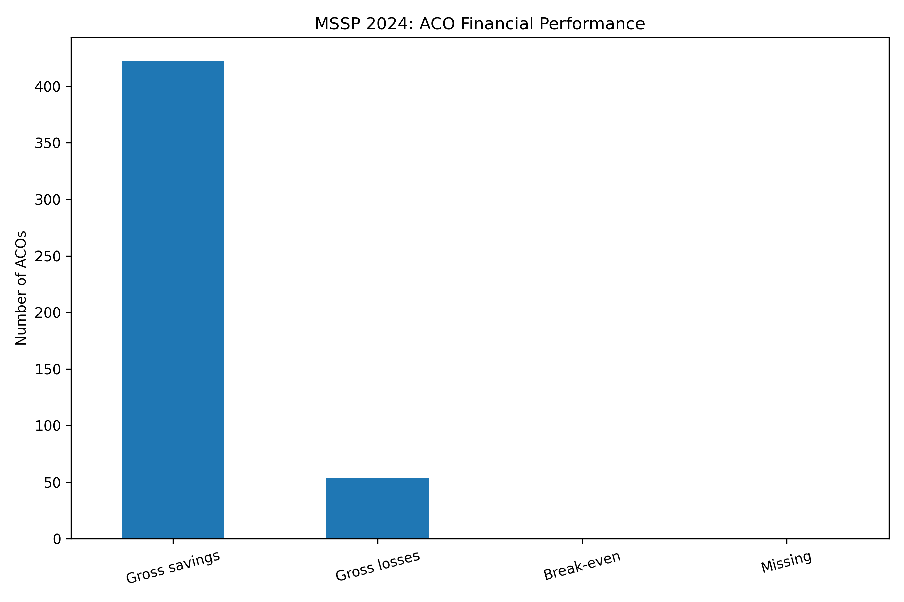
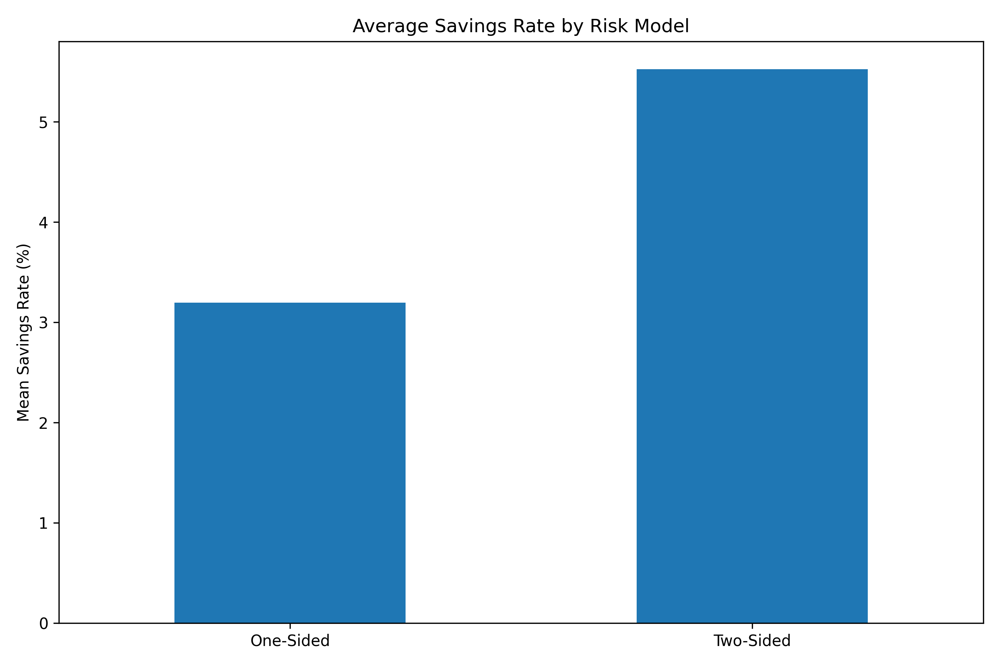
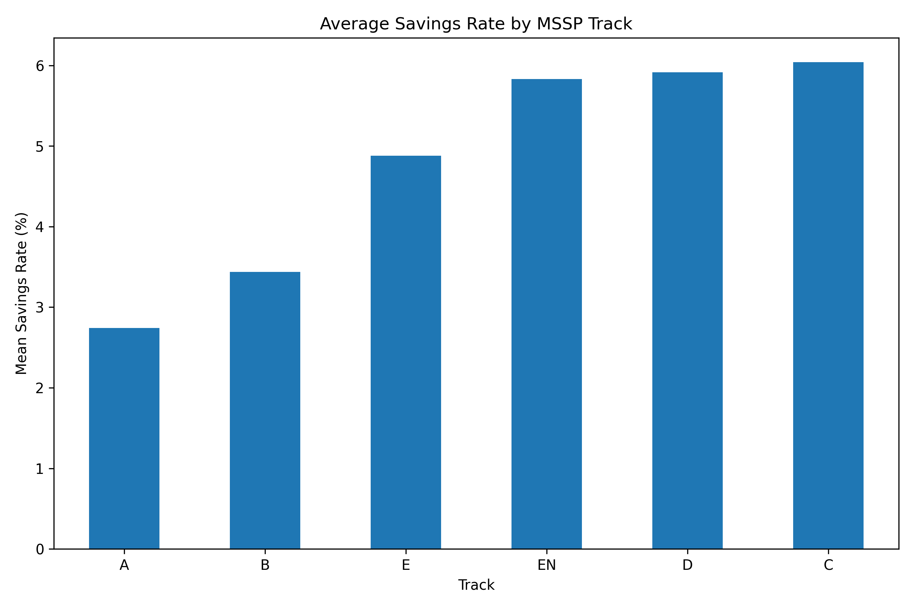
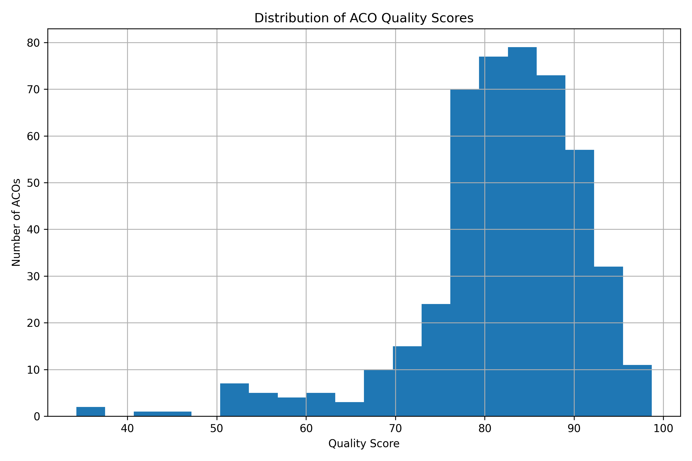
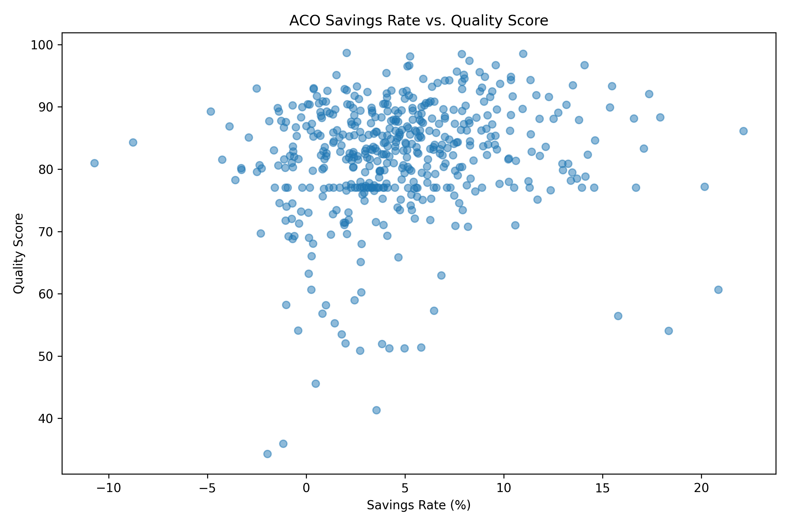

# Medicare Shared Savings Program: ACO Performance, 2024

Analysis of CMS financial and quality results for 476 Medicare Shared Savings Program (MSSP) Accountable Care Organizations (ACOs) in performance year 2024.

## Results

| Measure | Result |
|---|---:|
| ACOs analyzed | 476 |
| ACOs with spending below benchmark | 422 (88.7%) |
| ACOs with spending above benchmark | 54 (11.3%) |
| Net benchmark minus expenditures | $6.61 billion |
| Net earned savings minus owed losses | $4.12 billion |
| Positive / zero / negative earned or owed amounts | 360 / 100 / 16 |
| Pearson correlation, savings rate and quality score | 0.157 |

The benchmark difference is not the same as the payment an ACO earns. Of the 54 ACOs with spending above benchmark, 16 reported negative owed amounts.

### Risk-model comparison

| Measure | One-sided | Two-sided |
|---|---:|---:|
| ACOs | 157 | 319 |
| Mean savings rate | 3.20% | 5.53% |
| Mean quality score | 78.44 | 83.60 |
| ACOs with spending below benchmark | 130 | 292 |

These are unweighted group summaries. Differences may reflect beneficiary populations, ACO size, experience, and other factors; they are not estimates of the effect of taking on financial risk.

## Figures

### Financial results by ACO


### Savings rate by risk model


### Savings rate by track


### Quality scores


### Savings rate and quality score


## Analysis

The scripts check ACO identifiers and missing values, convert reported financial fields to numeric types, classify benchmark savings and losses, and summarize financial and quality results by risk model and track. The advanced script also produces ACO rankings, a correlation matrix, five figures, and a Markdown results report.

- `medicare-apm-monitoring.py`: initial financial summaries and rankings
- `medicare-apm-advanced.py`: financial and quality summaries, figures, and report
- `output_advanced/`: exported results and figures

### Selected tables

- [ACO monitoring table](output_advanced/aco_monitoring_table.csv)
- [Results by risk model](output_advanced/financial_by_risk_model.csv)
- [Results by track](output_advanced/financial_by_track.csv)
- [Correlation matrix](output_advanced/descriptive_correlations.csv)
- [Results report](output_advanced/monitoring_report.md)

## Data and reproducibility

Source: Centers for Medicare & Medicaid Services, **MSSP Performance Year 2024 ACO Financial and Quality Results**.

Download the public CMS CSV and place it in the same directory as the scripts. The expected filename is:

```text
PY_Financial_and_Quality_Results_2024_revised 2026_07_17.csv
```

Install dependencies and run:

```bash
pip install pandas numpy matplotlib
python medicare-apm-monitoring.py
python medicare-apm-advanced.py
```

On Windows, `py` can replace `python`. Results are written to `output/` and `output_advanced/`, respectively.

## Limitations

This is a single-year descriptive analysis, not a causal comparison or an independent CMS payment reconciliation. Group means are unweighted. Gross dollar savings are influenced by ACO size; quality scores are taken as reported. The comparison between `Sav_rate` and `MinSavPerc` is exploratory and should not be used as an official eligibility test. Missing values may reflect differences in reporting applicability.
